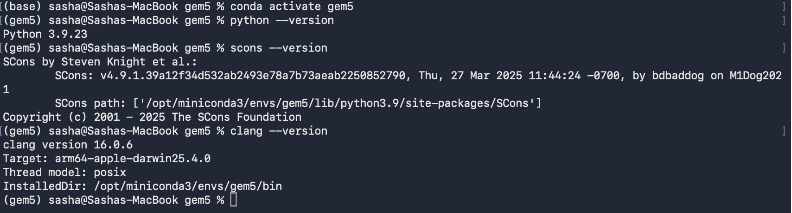
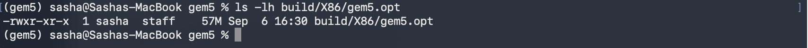
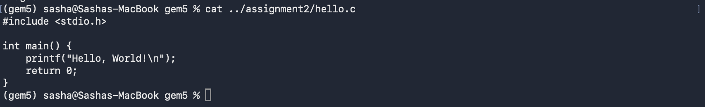
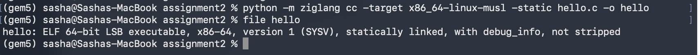
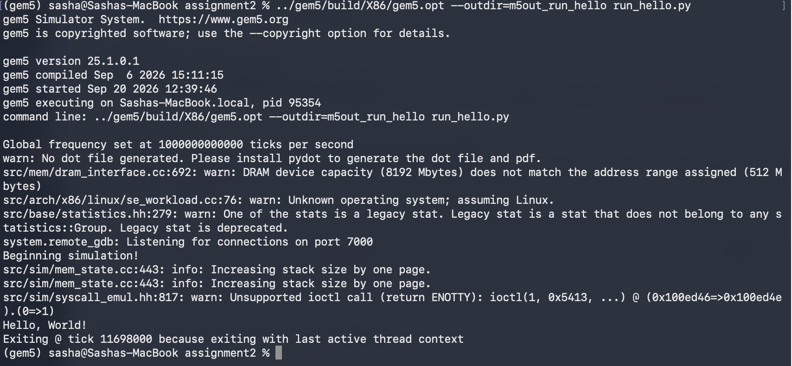
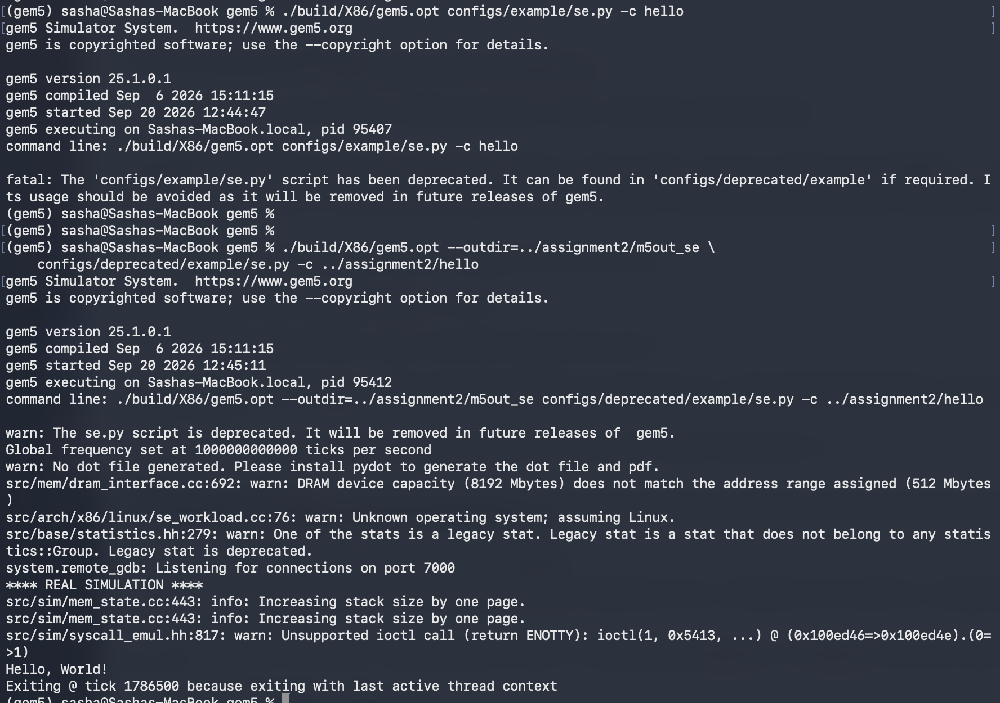
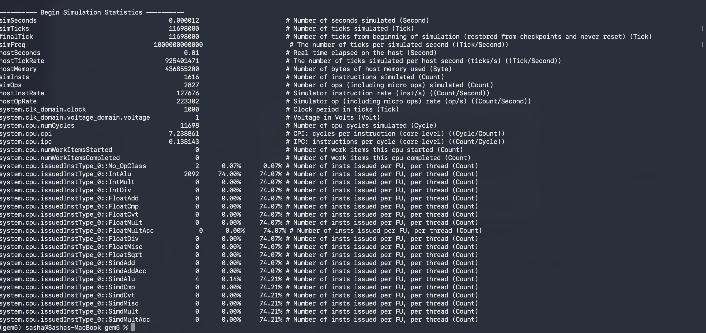

# Assignment 2: Using gem5 with a "Hello World" Program for the x86 ISA

**Name:** I Chen
**Course:** MSCS531 – Computer Architecture

> **Note on how this was produced:** Every command, error message, and statistic below is real output from my own Mac (Apple Silicon, macOS, 6 CPU cores, 8 GB RAM), using the gem5 build from Assignment 1 (gem5 v25.1.0.1, X86 target, `build/X86/gem5.opt`, `stable` branch at commit `cbc94c1`). The assignment handout was written for an older gem5 release and for a Linux/x86 host, so several of its instructions did not work as written on my machine. Those problems, and how I resolved each one, are documented in Section 6 exactly as they happened. All files referenced here (`hello.c`, `run_hello.py`, the logs, and the `m5out*/` results) are in the `assignment2/` folder of my repository.

---

## 1. Environment Setup

The assignment requires Python, SCons, and a C++ compiler. Rather than the handout's Ubuntu `apt-get` commands, I used the conda environment named `gem5` from Assignment 1:




## 2. Building gem5 for x86

Running the following builds gem5 on my machine:

```bash
scons build/X86/gem5.opt -j6
```

The build produced a 57 MB `build/X86/gem5.opt` executable in about 20 minutes; the full build/troubleshooting process is outlined in my Assignment 1 report. Because the build was up to date, I only had to confirm it was present:

```bash
ls -lh build/X86/gem5.opt
```



## 3. Writing the "Hello World" Program

I created `hello.c` exactly as given in the handout:

```c
#include <stdio.h>

int main() {
    printf("Hello, World!\n");
    return 0;
}
```



## 4. Compiling the Program

### 4.1 Why the handout's command does not work on my machine

The handout says to compile with `gcc hello.c -o hello`. On my Mac that compiles for the *host* machine, not for the simulated one:

```
$ which gcc
/usr/bin/gcc

$ gcc --version | head -2
Apple clang version 21.0.0 (clang-2100.1.1.101)
Target: arm64-apple-darwin25.4.0

$ gcc hello.c -o hello_native && file hello_native
hello_native: Mach-O 64-bit executable arm64
```

On macOS, `gcc` is really Apple's Clang, and it produced an **arm64 macOS (Mach-O)** executable. gem5's X86 SE mode needs an **x86-64 Linux (ELF)** executable, and it rejects the native binary immediately:

```
ValueError: <path>/hello_native: the file is not an object file compatible with gem5.
  run_hello.py(73): <module>
```

(Full log: `troubleshooting/native_binary_attempt.log`.) On an x86-64 Linux host, the handout's plain `gcc` command would have produced the right kind of file. On an Apple Silicon Mac, a cross-compiler is needed.

### 4.2 Cross-compiling with `zig cc`

I used **Zig's bundled Clang** (`zig cc`), which includes a built-in Linux C library (musl) and can cross-compile to almost any target (Kelley, 2020). It installs from pip:

```bash
pip install ziglang        # inside the gem5 conda environment; Zig 0.16.0
cd ../assignment2
python -m ziglang cc -target x86_64-linux-musl -static hello.c -o hello
file hello
```

```
hello: ELF 64-bit LSB executable, x86-64, version 1 (SYSV), statically linked, with debug_info, not stripped
```

The flags matter: `-target x86_64-linux-musl` selects x86-64 Linux, and `-static` links everything into one self-contained file. SE mode has no dynamic loader or shared libraries to rely on, so a statically linked binary is the safest choice. The result is a 64-bit x86 Linux ELF executable, about 1.6 MB, that gem5 can run.



## 5. Running the Program in gem5

### 5.1 The simulation script

The handout supplies a script, `run_hello.py`, that builds a simulated computer: a 1 GHz clock, 512 MiB of DDR3 memory, a `TimingSimpleCPU` with 32 KiB L1 instruction and data caches, and a memory bus connecting them. The script runs the compiled `hello` binary on that system. The handout's version was written for an older gem5 and **does not run on gem5 v25.1**. When I ran it unchanged it failed immediately (see Section 6 for the full sequence of errors and fixes). I made some small changes to get `run_hello.py`, to work in my env; it is stored in the `assignment2/` folder.

The corrected script builds this system:

```
 TimingSimpleCPU ──► L1 I-cache (32 KiB) ──┐
   (x86, 1 GHz)  ──► L1 D-cache (32 KiB) ──┼──► memory bus ──► DDR3-1600 memory (512 MiB)
   interrupt controller ───────────────────┘        ▲
                                     system port ───┘
```

### 5.2 Running the simulation

```bash
cd ~/MSCS531_CompArch/assignment2
../gem5/build/X86/gem5.opt --outdir=m5out_run_hello run_hello.py
```

(`--outdir` keeps this run's results in their own folder so later runs do not overwrite them.)

Output from the run:



The line **`Hello, World!`** is printed by my compiled program, running on the simulated x86 CPU, and the simulation then exits normally because the program's last thread finished.

### 5.3 SE Script

The handout also suggests running the binary with gem5's stock SE script:

```bash
./build/X86/gem5.opt configs/example/se.py -c hello
```

In this gem5 version that script is only a stub that stops with an error:

```
fatal: The 'configs/example/se.py' script has been deprecated. It can be found in 'configs/deprecated/example' if required. Its usage should be avoided as it will be removed in future releases of gem5.
```

The working path is `configs/deprecated/example/se.py` (the same script I used in Assignment 1):

```bash
cd ~/MSCS531_CompArch/gem5
./build/X86/gem5.opt --outdir=../assignment2/m5out_se \
    configs/deprecated/example/se.py -c ../assignment2/hello
```

This also printed `Hello, World!` and exited at tick 1786500.



## 6. Troubleshooting Log

I hit these problems in this order. The intermediate scripts (`troubleshooting/step1.py` to `step6.py`) and their logs (`step1.log` to `step6.log`) are saved so each fix can be reproduced.

| # | Symptom (real message) | Cause | Fix |
|---|---|---|---|
| 1 | `hello_native: the file is not an object file compatible with gem5.` | The handout's `gcc hello.c -o hello` built an arm64 macOS (Mach-O) binary on my Apple Silicon Mac; gem5's X86 SE mode needs an x86-64 Linux ELF. | Cross-compiled with `zig cc -target x86_64-linux-musl -static` (Section 4.2). |
| 2 | `NameError: name 'L1_ICache' is not defined` (`troubleshooting/handout_run1.log`) | `L1_ICache` and `L1_DCache` are not part of `m5.objects`. They were helper classes from an older tutorial, not gem5 built-ins. | Defined `L1Cache`, `L1_ICache`, and `L1_DCache` in the script as subclasses of gem5's `Cache`, and added `import m5` as the gem5 tutorial script does (`step1.py`). |
| 3 | `AttributeError: object 'SystemXBar' has no attribute 'slave'` | gem5 renamed the crossbar's `slave`/`master` ports to `cpu_side_ports`/`mem_side_ports`. | Replaced `membus.slave` with `membus.cpu_side_ports` (`step2.py`). |
| 4 | `Error setting param X86TimingSimpleCPU.workload to <orphan System>.workload` | The handout assigned the `SEWorkload` object to `cpu.workload`, but the CPU's workload must be a `Process` describing the program to run. | Created `process = Process()` with `process.cmd = [binary]`, and kept `SEWorkload.init_compatible(binary)` on the system (`step4.py`). |
| 5 | `fatal: Cache ports on system.cpu.dcache are not connected` | The handout created caches but never wired them in: the CPU ports went straight to the memory bus, leaving the caches dangling. | Wired CPU → cache → bus: `cache.cpu_side = cpu.icache_port` (and `dcache_port`), `cache.mem_side = membus.cpu_side_ports` (`step5.py`). |
| 6 | `panic: panic condition !intRequestPort.isConnected() occurred: Int port not connected to anything!` (`src/arch/x86/interrupts.cc:331`) | On x86 the CPU's interrupt controller (created by `createInterruptController()`) has ports that must also be attached to the memory bus. The handout omitted this. | Connected `cpu.interrupts[0].pio`, `.int_requestor`, and `.int_responder` to the memory bus (`step6.py`). The simulation then ran successfully. |
| 7 | `fatal: The 'configs/example/se.py' script has been deprecated.` | The handout's stock SE script was moved in newer gem5 releases. | Used `configs/deprecated/example/se.py` (Section 5.3). |

Two further changes were made to the handout script without a separate error, because I was following gem5's own up-to-date tutorial (`configs/learning_gem5/part1/simple.py`; gem5 project, n.d.) and the earlier errors had already stopped the script before they could occur:
- **Memory controller.** The handout sets `system.mem_ctrl = DDR3_1600_8x8()`. `DDR3_1600_8x8` describes a DRAM device, not a controller, so I used `MemCtrl()` with `mem_ctrl.dram = DDR3_1600_8x8()` and connected `mem_ctrl.port` to the memory bus.
- **System port.** I added `system.system_port = system.membus.cpu_side_ports`, which the tutorial connects so gem5 itself can access simulated memory. The simulation also ran without it in `step6.py`, so it is a best-practice addition.
- I also switched the size strings to `"512MiB"` and `"32KiB"`, which removed the warning `Base 10 memory/cache size 512MB will be cast to base 2 size 512MiB`.

**Warnings that appear in the successful run and are harmless:**
- `DRAM device capacity (8192 Mbytes) does not match the address range assigned (512 Mbytes)`: the DDR3 device model describes 8 GiB, but I assigned it a 512 MiB address range. The simulation only uses the assigned range.
- `Unknown operating system; assuming Linux.`: a static musl ELF file does not carry a Linux OS marker in its header, so gem5 assumes Linux, which is what we want.
- `Unsupported ioctl call (return ENOTTY): ioctl(1, 0x5413, ...)`: the C library asks whether standard output is a terminal (`0x5413` is `TIOCGWINSZ`) so it can choose line buffering. gem5 answers "not a terminal", and the program prints normally.
- `Increasing stack size by one page`: the program's stack grew slightly, and gem5 extended it automatically.
- `No dot file generated`: `pydot` is not installed; it is only needed to draw the system as a diagram.

## 7. Analyzing the Output

The message **`Hello, World!`** appeared, confirming that gem5 loaded my cross-compiled x86-64 program, executed its instructions on the simulated x86 CPU, and emulated the `write` and `exit` system calls the program made. gem5 also writes detailed statistics to `m5out_run_hello/stats.txt`:

```bash
cat m5out_run_hello/stats.txt | head -40
```

Key statistics from the two runs (from each run's `stats.txt`):

| Statistic | `run_hello.py` (TimingSimpleCPU + L1 caches) | `configs/deprecated/example/se.py` (AtomicSimpleCPU, no caches) |
|---|---|---|
| `simInsts` (instructions committed) | 1,616 | 1,730 |
| `simTicks` (simulated ticks; 1 THz tick rate) | 11,698,000 (≈ 11.7 µs) | 1,786,500 (≈ 1.79 µs) |
| `system.cpu.numCycles` | 11,698 | 3,574 |
| `system.cpu.cpi` (cycles per instruction) | 7.24 | 2.07 |
| `system.cpu.ipc` (instructions per cycle) | 0.138 | 0.484 |
| L1 I-cache hits / misses | 2,049 / 55 (2.6% miss rate) | no caches |
| L1 D-cache hits / misses | 683 / 46 (6.3% miss rate) | no caches |

How to read this:
- **Simulated time vs. real time.** With a 1 GHz clock, 11,698,000 ticks is 11,698 cycles, and gem5 finished simulating them in about 0.01 seconds of real time (`hostSeconds`). Detailed simulation costs real time, but this program is tiny.
- **A high CPI is expected for a tiny program.** `hello` executes only about 1,600 instructions, and the caches start empty. Every first touch of a cache line is a miss that must be fetched from DRAM (there were 55 instruction and 46 data misses), and each miss costs many cycles. With so few instructions to amortize that startup cost, the average CPI (7.24) is far above 1.
- **The two runs are not directly comparable.** They use different CPU models and memory configurations. The `configs/deprecated/example/se.py` run used `AtomicSimpleCPU` with atomic-mode memory accesses and no caches (visible in `m5out_se/config.ini`), which uses a much simpler timing model, so its cycle counts are not a like-for-like measurement against the timing-mode run. The instruction counts also differ (1,616 vs. 1,730), even though both runs execute the same `hello` binary. The only input that differed was the path passed to the program: `hello` (5 characters) for `run_hello.py` and `../assignment2/hello` (20 characters) for `se.py`. An earlier `se.py` run that used the full absolute path (47 characters) executed 1,889 instructions. So the instruction count rises with the length of the program path (5 → 1,616; 20 → 1,730; 47 → 1,889), which is consistent with the program's startup code handling its command-line and stack contents. Three data points fit that pattern, but I did not verify the exact cause.



## 8. Lessons Learned

1. **The binary must match the simulated machine, not the host.** gem5 simulates an x86 CPU running Linux, so the program has to be an x86-64 Linux executable no matter what the host computer is. My first attempt, a native compile on an Apple Silicon Mac, failed for exactly this reason. Learning to check a file with `file` before simulating it saves a lot of confusion, and the situation showed why cross-compilation is a normal part of architecture work.
2. **Syscall-emulation mode trades realism for simplicity.** gem5 did not boot an operating system. It ran one program and answered its system calls itself, which is why a static binary was necessary, and why warnings such as the `ioctl` message appeared: gem5 is answering questions a real kernel would normally answer.
3. **In gem5 you assemble the computer yourself, and every connection matters.** The handout's script created caches but never connected them, and forgot the x86 interrupt controller's ports, so gem5 refused to run with clear `fatal` and `panic` messages. Building the simulated system taught me the structure of a real one: CPU, L1 caches, memory bus, memory controller, DRAM, and interrupt controller.
4. **Documentation and APIs age quickly.** The handout's script and paths were written for an older gem5. Port names changed (`slave` to `cpu_side_ports`), the stock SE script moved, and helper classes disappeared. The most reliable references were the example scripts shipped inside the gem5 source tree (`configs/learning_gem5/`), which match the version I actually built.
5. **Simulator statistics show microarchitecture at work.** Even a program that just prints one line has measurable cache behavior: a 2.6% instruction-cache miss rate and a 6.3% data-cache miss rate on cold caches, producing a CPI of 7.24 for a program too short to amortize its startup misses. Changing the CPU model (timing vs. atomic) changed the numbers significantly, which shows why choosing the right level of simulator detail matters.
6. **Reading the error message and fixing one thing at a time works.** gem5's errors were specific. Each fix moved the failure to the next problem, and keeping every intermediate script and log made the whole process reproducible and documentable.

---

## References

Binkert, N., Beckmann, B., Black, G., Reinhardt, S. K., Saidi, A., Basu, A., Hestness, J., Hower, D. R., Krishna, T., Sardashti, S., Sen, R., Sewell, K., Shoaib, M., Vaish, N., Hill, M. D., & Wood, D. A. (2011). The gem5 simulator. *ACM SIGARCH Computer Architecture News, 39*(2), 1–7. https://doi.org/10.1145/2024716.2024718

gem5 project. (n.d.). *Learning gem5, Part 1: Creating a simple configuration script*. https://www.gem5.org/documentation/learning_gem5/part1/simple_config/

Kelley, A. (2020, March 20). *`zig cc`: A powerful drop-in replacement for GCC/Clang*. https://andrewkelley.me/post/zig-cc-powerful-drop-in-replacement-gcc-clang.html
