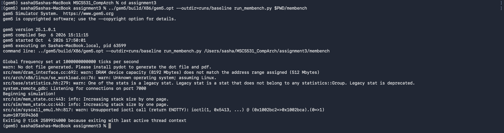
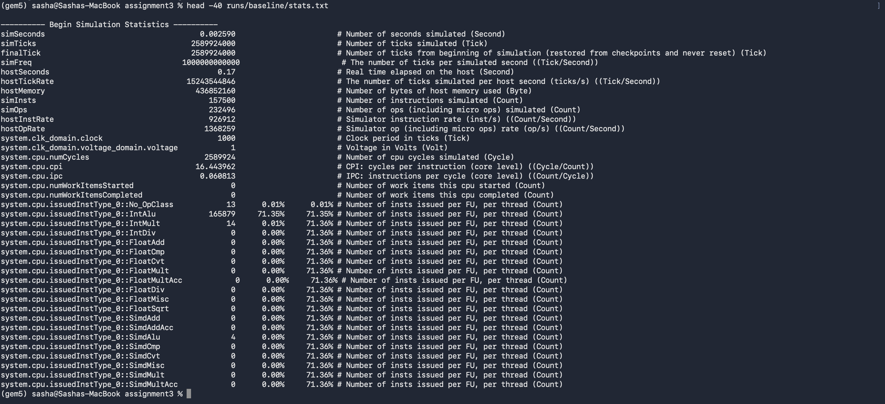

# Assignment 3: Exploring Memory Hierarchy Design in gem5

**Name:** Sasha Chen
**Course:** MSCS531 – Computer Architecture

> **Note on how this was produced:** Part 2 results are real output from my own Mac (Apple Silicon, macOS, gem5 v25.1.0.1, X86 target, the gem5 build from Assignment 1). The gem5 environment was already set up from earlier assignments. All runs, configuration files, and statistics referenced here are in the `assignment3/` folder of my repository (`runs/`, `results_cache.csv`, `run_membench.py`, `membench.c`).

---

## Part 1: Understanding Memory Hierarchy

Modern processors execute instructions far faster than main memory can supply data. A memory hierarchy bridges this gap by placing small, fast storage close to the processor and larger, slower storage further away. Programs run well when most accesses are served by the fast levels, which is possible because programs exhibit temporal locality (recently used data is used again) and spatial locality (nearby data is used together). The hierarchy's performance therefore depends on both the hardware and the access pattern of the workload (Hennessy & Patterson, 2017).

### Memory technologies

The levels of the hierarchy use different technologies, each with a trade-off between speed, density, and cost. Static RAM (SRAM) stores each bit in a small number of transistors that hold their state while powered. It is very fast, with access times of a few cycles for small arrays, but it takes several transistors per bit, so it is expensive per byte and occupies a lot of die area. SRAM is therefore used for caches and register files. Dynamic RAM (DRAM) stores each bit as charge in a single capacitor, which is dense and cheap but must be periodically refreshed and takes tens of nanoseconds to access. Main memory is built from DRAM. Below DRAM, flash and disk trade latency for capacity and persistence. The access latency gap between SRAM caches and DRAM is what makes cache placement so important: the more often a request is served by SRAM, the lower the average access time.

These characteristics determine placement. Levels closest to the processor must be small and fast, so they use SRAM and are limited in capacity. Lower levels can be larger and slower, so they use DRAM or storage. Each level holds a subset of the data in the level below it, and the hierarchy only works when that subset contains the data the processor needs most often.

### Advanced cache optimization

Basic cache organization (capacity, block size, and associativity) determines how many misses occur. Several techniques reduce misses or the cost of each miss further (Hennessy & Patterson, 2017).

**Prefetching** requests data before the processor asks for it, which converts future misses into hits. Hardware prefetchers detect regular strides or streams and fetch the next blocks ahead of use. Prefetching helps streaming workloads most, but a poor prediction wastes bandwidth and can evict useful data.

**Victim caches** are small, fully associative buffers that hold blocks recently evicted from a direct-mapped or low-associativity cache. A conflict miss that would have gone to memory can instead be served from the victim buffer, which removes much of the penalty of conflicts at low hardware cost. Jouppi (1990) showed that a few entries can remove a large fraction of conflict misses.

**Cache partitioning** divides a shared cache among cores, threads, or workloads so that one workload cannot evict another's data. In multi-programmed systems this improves fairness and throughput, although partitions that are too small can increase misses for each workload.

These techniques address different miss types. Prefetching targets compulsory and capacity misses on predictable streams, victim caches target conflict misses, and partitioning targets interference between workloads that share a cache.

### Virtual memory and virtual machines

Virtual memory gives each process its own address space, mapped to physical memory by page tables maintained by the operating system. Each access must translate a virtual address to a physical address, and the translation is cached in the translation lookaside buffer (TLB). A TLB miss requires a page-table walk, which adds memory accesses and latency. Keeping the working set of pages small enough for the TLB to cover is therefore central to performance. When physical memory is full, the operating system replaces pages using policies such as least recently used (LRU) or clock approximations of it; a page fault that must read from disk costs orders of magnitude more than a cache miss.

Virtual memory supports concurrent processes by isolating their address spaces and sharing physical memory among them. Virtual machines add another translation level: a hypervisor maps guest physical addresses to host physical addresses, typically with hardware-assisted nested paging. This increases the cost of a TLB miss because the walk can span both levels, so virtual machines make the memory hierarchy's translation path more important for performance.

### Cross-cutting issues

Designing a memory hierarchy involves trade-offs. Larger caches reduce misses but cost area, power, and access latency. Higher associativity reduces conflict misses but needs more comparators and more energy per access. Larger blocks exploit spatial locality but increase the penalty of each miss and waste capacity when data is used sparsely. The best choice depends on the workload: streaming codes benefit from large blocks and prefetching but gain little from associativity, while pointer-chasing codes gain from associativity and victim caches.

Emerging trends include 3D-stacked and on-package DRAM that narrow the gap between cache and main memory, non-volatile memories that blur the line between memory and storage, and heterogeneous memory systems that place data across technologies according to access patterns. These changes make the hierarchy more complex, so simulation and measurement remain essential for evaluating design choices.

---

## Part 2: Implementing and Analyzing Cache Configurations in gem5

### 2.1 Benchmark and configuration

I wrote a small benchmark, `membench.c`, that walks a 256 KiB array with a 64-byte stride for eight passes. On each step it writes and then reads one element. The array is larger than any L1 data cache in the sweep except the 256 KiB case, so the workload tests how the cache handles capacity pressure and streaming access. I compiled it with the same cross-compiler as Assignment 2, using the static x86-64 Linux target at `-O2`:

```bash
cd ~/MSCS531_CompArch/assignment3
python -m ziglang cc -target x86_64-linux-musl -static -O2 membench.c -o membench
```

The gem5 configuration script, `run_membench.py`, builds the system from Assignment 2 with three command-line options: the L1 data cache size (`--l1d-size`), its associativity (`--l1d-assoc`), and the cache block size (`--block-size`, which sets `system.cache_line_size`). The baseline uses a 32 KiB, 2-way L1 data cache with 64-byte blocks, and the L1 instruction cache is 32 KiB. The data cache has a 2-cycle hit latency (`data_latency`), and the clock period is 1000 ticks per cycle.

Example baseline run:

```bash
../gem5/build/X86/gem5.opt --outdir=runs/baseline run_membench.py $PWD/membench
```



### 2.2 Baseline

The baseline run committed 157,500 instructions in 2,589,924,000 ticks. The L1 data cache received 66,584 accesses and missed 32,829 times, a miss rate of 0.493. The average miss latency was 62,601.8 ticks (about 62.6 cycles), which includes the trip to DRAM. Average memory access time (AMAT) combines hits and misses:

AMAT = hit time + miss rate × miss penalty

With a 2-cycle hit time and the measured miss latency, the baseline AMAT is 2 + 0.493 × 62.6 ≈ 32.9 cycles.



### 2.3 Optimizing cache parameters

I changed one parameter at a time, rerunning the benchmark each time, and kept the others at baseline. Table 1 shows the results for every run. AMAT uses the same hit time and the measured miss latency for each configuration.

**Table 1.** L1 data cache results for the benchmark in each configuration.

| Configuration | Miss rate | Misses | Avg. miss latency (cycles) | AMAT (cycles) | Simulated ticks |
|---|---|---|---|---|---|
| Baseline (32 KiB, 2-way, 64 B) | 0.4930 | 32,829 | 62.6 | 32.9 | 2,589,924,000 |
| Size 8 KiB | 0.4930 | 32,829 | 63.3 | 33.2 | 2,611,288,000 |
| Size 16 KiB | 0.4930 | 32,829 | 63.1 | 33.1 | 2,604,657,000 |
| Size 64 KiB | 0.4930 | 32,829 | 61.7 | 32.4 | 2,561,466,000 |
| Size 256 KiB | 0.0624 | 4,156 | 56.2 | 5.5 | 825,483,000 |
| Associativity 1-way | 0.4930 | 32,829 | 62.6 | 32.9 | 2,589,924,000 |
| Associativity 4-way | 0.4930 | 32,829 | 62.6 | 32.9 | 2,589,924,000 |
| Associativity 8-way | 0.4930 | 32,829 | 62.6 | 32.9 | 2,589,924,000 |
| Block size 32 B | 0.4934 | 32,855 | 62.7 | 32.9 | 2,598,132,000 |
| Block size 128 B | 0.2467 | 16,424 | 73.0 | 20.0 | 1,834,119,000 |

The raw data are in `results_cache.csv`.

**Cache size.** Increasing the L1 data cache from 8 KiB to 64 KiB changed nothing in the miss count. The benchmark writes and reads a 256 KiB array on every pass, so the cache holds only a fraction of the working set and each pass evicts the lines it will need on the next pass. Each of the eight passes therefore misses on every line, which accounts for the 32,829 misses (about 8 × 4,096). Only when the cache reached 256 KiB, which holds the whole array, did the miss count fall to 4,156. That is close to the 4,096 cache lines in the array, so the remaining misses are almost all compulsory misses on the first pass. The AMAT drop from 32.9 to 5.5 cycles shows how much DRAM latency the hierarchy hides when the working set fits.

**Associativity.** Changing associativity from 1-way to 8-way had no effect on misses. The benchmark touches the array in a single sequential stride, so each set receives the same stream of blocks, and no two blocks compete for a set in a way that more ways would prevent. Conflict misses require several frequently used addresses to map to the same set, which this pattern does not produce. Associativity would matter for workloads with repeated accesses to a few conflicting addresses, which this benchmark does not contain.

**Block size.** Doubling the block size from 64 to 128 bytes halved the misses (32,829 to 16,424). Each 64-byte stride access now falls on a block that the previous access already brought in, so every other access hits. The benefit comes from spatial locality in the access pattern. The cost is visible in the average miss latency, which rose from 62.6 to 73.0 cycles, because each miss transfers a larger block. The net AMAT improved from 32.9 to 20.0 cycles. Reducing the block size to 32 bytes slightly increased misses and gave no benefit, because the stride skips over the smaller block.

### 2.4 Virtual memory

The virtual-memory experiment was run in gem5's full-system (FS) mode. In syscall-emulation (SE) mode the TLB is not exercised: every TLB counter stays at zero, and changing the TLB size has no effect on results. FS mode boots a real Linux kernel, which performs address translation through the TLBs.

**Setup.** The guest ran Linux 5.4.49 on an Ubuntu 18.04 disk image with one x86 CPU, the same 32 KiB L1 instruction and data caches used in Section 2.3, and 4 KiB pages. The CPU was the atomic model, which still performs address translation. I set the instruction and data TLBs to 4 entries (`run_fs_tlb.py --tlb-size 4`). The benchmark (`membench`, the same program as Section 2.1) was copied into the guest through the m5 readfile script, and the statistics were reset immediately before it ran.

**Result.** Table 2 reports the counters for the benchmark run. Because the statistics were reset just before the benchmark, the counts include kernel work during that window, such as loading the program and handling page faults, not only the benchmark's own accesses.

**Table 2.** Data and instruction TLB results for the benchmark with 4-entry TLBs (FS mode).

| TLB | Accesses | Misses | Miss rate |
|---|---|---|---|
| Data (dtb) | 1,096,552 (read 608,569; write 487,983) | 71,202 (read 65,300; write 5,902) | 0.065 (6.5%) |
| Instruction (itb) | 2,708,824 | 4,618 | 0.0017 (0.17%) |

The benchmark produced the same output as in SE mode (`sum=1073594368`), confirming that it ran correctly in the guest. Simulated time for the run was 5,604,339,000 ticks, and 2,067,548 instructions committed.

**Interpretation.** The array spans 256 KiB, which is 64 pages of 4 KiB. A 4-entry data TLB cannot hold a sweep across 64 pages, so most page transitions miss, and the measured data miss rate of 6.5% is consistent with that. The instruction side has a much smaller footprint (a short loop), so its miss rate is low.

**Limitations.** This is one measured configuration. The default gem5 x86 TLB has 64 entries per TLB. Because the array spans 64 pages, a 64-entry TLB could hold all of them, and I expect its data miss rate to be much lower. I did not measure this, so it is a prediction from the reasoning above, not a result. The benchmark's own TLB behavior is also not separated from the kernel's activity in the same window, and page-fault counts are not reported here.

### 2.5 Discussion

The cache results show that the effect of a hierarchy parameter depends on the access pattern, not only on its size. Capacity dominated the benchmark: until the cache could hold the 256 KiB array, growing it helped nothing, and then it helped enormously. Block size mattered because the stride gave spatial locality within each block, while associativity mattered not at all because the pattern produced no conflicts. A single parameter can therefore look ineffective for one workload and decisive for another.

The AMAT calculation links the miss counts to performance. A reduction in miss rate only helps if the miss penalty does not grow faster, which the 128-byte block case illustrates: the miss rate halved, the miss penalty rose by about 17%, and AMAT still fell by about 39%. Evaluating a configuration therefore needs both the miss rate and the cost of a miss.

These observations relate to the optimization techniques in Part 1. The block-size result is spatial prefetching in effect: a larger block brings in neighboring data before it is requested. Victim caches and associativity address conflict misses, which this benchmark does not produce, so their benefit would appear only in a conflict-heavy workload.

### 2.6 Troubleshooting

- **TLB configuration error.** My first configuration script created the TLBs without an entry type. gem5 stopped with `fatal: system.cpu.dtb.entry_type without default or user set value`. Setting `entry_type="instruction"` for the instruction TLB and `entry_type="data"` for the data TLB fixed it.
- **TLB counters remained zero in SE mode.** My first runs used syscall-emulation mode, where the TLB is never exercised. Setting the TLB size to 1 entry produced identical ticks and misses to the 64-entry run (2,589,924,000 ticks and 32,829 misses), confirming the TLB had no effect. I moved the virtual-memory experiment to full-system mode, where the TLB counters are non-zero and respond to the TLB size.
- **Repeated-loop reporting.** Parsing statistics across all runs in one shell loop failed under zsh because of its globbing rules. Running the same loop under bash produced the table in Section 2.3.

---
- **Full-system boot failed on the first try.** The kernel panicked with `No filesystem could mount root`. The kernel command line said `root=/dev/hda`, but the disk's root filesystem is on partition 1. I set `root_partition="1"` on the disk image resource, which fixed the boot. The failed log is kept as `runs/fs_boot_attempt1_rootdev.log`.
- **gem5's Python `Simulator` class would not load.** It uses Python 3.10 type syntax (`X | Y`), but the Python 3.9 embedded in this build cannot parse it. The script calls the same setup steps directly (`board._pre_instantiate`, `m5.instantiate`, `board._post_instantiate`, `m5.simulate`).
- **Getting the benchmark into the guest.** The disk image is ext4, and this Mac has no ext4 tools in the gem5 environment. I encoded the stripped 21 KB binary in base64 inside the readfile script, and the guest decodes it to `/root/membench` before running it.


## References

Binkert, N., Beckmann, B., Black, G., Reinhardt, S. K., Saidi, A., Basu, A., Hestness, J., Hower, D. R., Krishna, T., Sardashti, S., Sen, R., Sewell, K., Shoaib, M., Vaish, N., Hill, M. D., & Wood, D. A. (2011). The gem5 simulator. *ACM SIGARCH Computer Architecture News, 39*(2), 1–7. https://doi.org/10.1145/2024716.2024718

Hennessy, J. L., & Patterson, D. A. (2017). *Computer architecture: A quantitative approach* (6th ed.). Morgan Kaufmann.

Jouppi, N. P. (1990). Improving direct-mapped cache performance by the addition of a small fully-associative cache and prefetch buffers. In *Proceedings of the 17th Annual International Symposium on Computer Architecture* (pp. 364–373). https://doi.org/10.1109/ISCA.1990.134547
